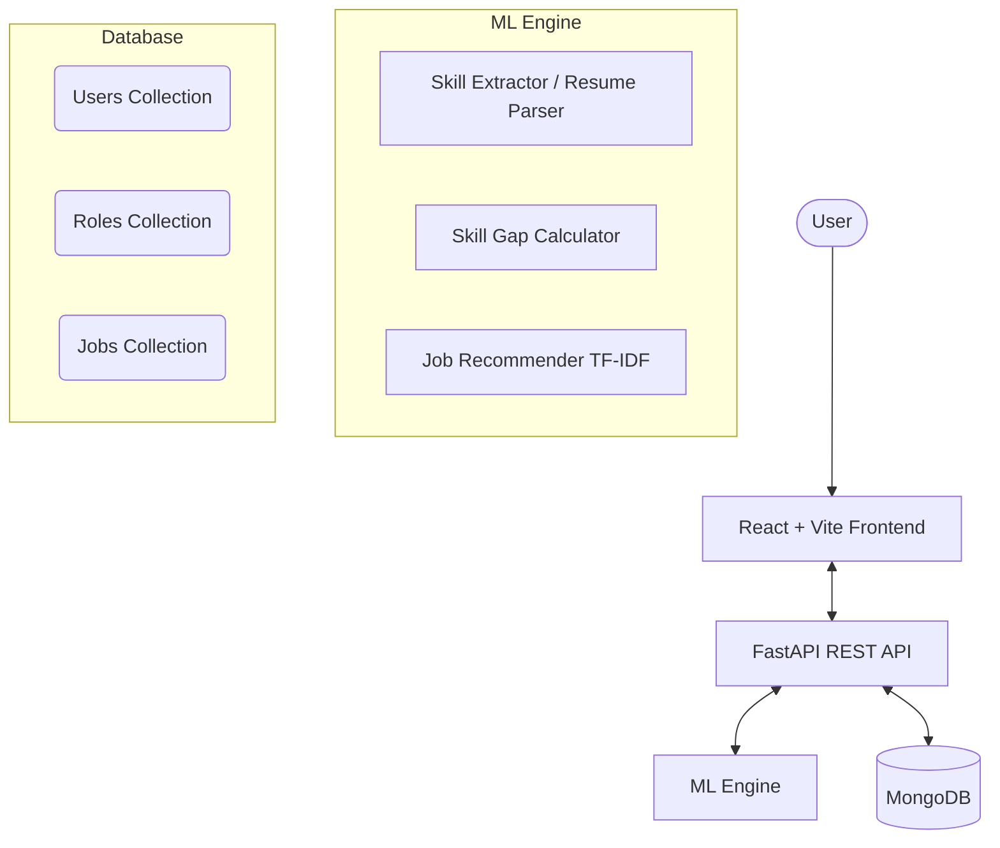

# AI Skill Gap & Job Recommendation System

A production-quality platform that analyzes a user's skills against industry standards, calculates their skill gap, provides a tailored learning roadmap, and recommends personalized job opportunities using Machine Learning.

## 🚀 Project Overview

The AI Skill Gap & Job Recommendation System is designed to bridge the gap between academic learning and industry requirements. By creating a professional profile and inputting their current skillset, users receive a detailed AI-driven analysis of how ready they are for their target role, exactly what skills they are missing, and which jobs they are currently most qualified for.

The application features a minimalist, premium product design that feels like a real-world SaaS platform, entirely avoiding the generic "AI slop" UI tropes.

---

## ✨ Features

- **Professional Profile Management**: Track education, experience, and target roles.
- **Skill Inventory**: Manage current skills with proficiency levels and categories.
- **Resume Parsing**: Automatically extract skills from uploaded PDF/DOCX resumes.
- **ML Skill Gap Analysis**: Calculate a precise "Readiness Score" based on skill importance and proficiency matching.
- **Learning Roadmap Generation**: Receive prioritized, step-by-step learning paths for missing skills.
- **Job Recommendations**: TF-IDF and Cosine Similarity-powered job matching with clear explainability on *why* a job was recommended.
- **Career Dashboard**: High-level analytics and visualizations of career readiness.

---

## 🏗 Architecture



## 💻 Tech Stack

**Frontend**
- React 18
- Vite
- Custom CSS System (No external UI frameworks to ensure complete design control)
- Recharts (for Dashboard analytics)
- Lucide React (Icons)

**Backend**
- Python 3
- FastAPI (REST API framework)
- PyMongo (Database driver)
- JWT (Authentication)
- PyMuPDF / python-docx (Resume parsing)

**Machine Learning**
- Scikit-learn (TF-IDF Vectorization, Cosine Similarity)
- Custom weighted heuristic algorithms for gap scoring

**Database**
- MongoDB (NoSQL)

---

## 🧠 ML Methodology

### 1. Skill Gap Analysis
The system uses a weighted scoring algorithm. Each target role has a required list of skills, each with a defined **Importance (1-5)** and **Level (Beginner to Expert)**. 
- The user's proficiency is numerically mapped.
- If the user meets or exceeds the required level, they receive the full importance score.
- If they partially meet it, they receive a proportional score.
- **Readiness Score** = `(Earned Score / Total Possible Importance Score) * 100`

### 2. Job Recommendation
The recommendation engine uses a hybrid content-based filtering approach:
- **TF-IDF Vectorization**: Converts the user's skill string and the job descriptions/requirements into a term-frequency inverse-document-frequency matrix.
- **Cosine Similarity**: Calculates the semantic distance between the user's profile vector and every job vector in the database.
- **Hybrid Scoring**: The final match percentage blends the pure cosine similarity score with a hard skill-overlap percentage (exact skill matching).
- **Explainability**: Based on the match score breakdown, the system generates a human-readable explanation (e.g., "Excellent skill match for your profile").

---

## 🗄 Database Schema (MongoDB)

### `users` collection
```json
{
  "_id": "ObjectId",
  "name": "string",
  "email": "string",
  "password": "string (hashed)",
  "profile": {
    "target_role": "string",
    "experience_level": "string",
    // ...other profile fields
  },
  "skills": [
    {
      "name": "string",
      "category": "string",
      "proficiency": "string",
      "years": "number"
    }
  ],
  "latest_analysis": {
    "target_role": "string",
    "result": "object"
  }
}
```

### `roles` collection
```json
{
  "role_id": "string",
  "title": "string",
  "description": "string",
  "skills": [
    {
      "name": "string",
      "category": "string",
      "importance": "number (1-5)",
      "level": "string"
    }
  ]
}
```

### `jobs` collection
```json
{
  "job_id": "string",
  "title": "string",
  "company": "string",
  "location": "string",
  "work_mode": "string",
  "experience": "string",
  "salary": "string",
  "description": "string",
  "required_skills": ["string"]
}
```

---

## 📡 API Documentation

| Method | Endpoint | Description | Auth Required |
|--------|----------|-------------|---------------|
| POST | `/api/auth/register` | Register a new user | No |
| POST | `/api/auth/login` | Authenticate and receive JWT | No |
| GET | `/api/auth/me` | Get current user basic info | Yes |
| GET | `/api/profile` | Get user profile data | Yes |
| PUT | `/api/profile` | Update user profile data | Yes |
| GET | `/api/skills` | List user's added skills | Yes |
| POST | `/api/skills` | Add a new skill to user profile | Yes |
| DELETE | `/api/skills/{name}` | Remove a skill | Yes |
| GET | `/api/roles` | Get all available career roles | No |
| POST | `/api/skill-gap/analyze`| Run ML gap analysis for target role | Yes |
| GET | `/api/skill-gap/latest` | Retrieve the last run analysis | Yes |
| GET | `/api/jobs` | Get all jobs in database | No |
| POST | `/api/jobs/recommended` | Get ML-recommended jobs for user | Yes |
| POST | `/api/resume/skills` | Upload PDF/DOCX to extract skills | Yes |

---

## ⚙️ Installation & Setup

### Prerequisites
- Node.js (v16+)
- Python (3.9+)
- MongoDB (running locally or via MongoDB Atlas)

### Environment Variables
Create a `.env` file in the `backend/` directory:
```env
# backend/.env
MONGO_URI=mongodb://localhost:27017
DB_NAME=skillgap_db
JWT_SECRET=your_super_secret_key_change_in_production
```

### 1. Run the Backend
```bash
cd backend
python -m venv venv

# Activate venv
# Windows: venv\Scripts\activate
# Mac/Linux: source venv/bin/activate

pip install -r requirements.txt
uvicorn app.main:app --reload
```
*Note: The backend automatically seeds the database with 20 roles and 100 demo jobs upon startup if the collections are empty.*

### 2. Run the Frontend
```bash
cd frontend
npm install
npm run dev
```
Open `http://localhost:5173` in your browser.

---

## 📸 Screenshots
*(To be added)*
- Landing Page
- Dashboard Analytics
- Skill Gap Analysis & Roadmap
- Job Recommendations

---

## 🔮 Future Improvements
- **Live Job API Integration**: Connect to LinkedIn/Indeed APIs to fetch real-time job listings instead of the demo dataset.
- **Advanced Resume Parsing**: Use an LLM for deeper semantic extraction of context from resumes.
- **Social Features**: Allow users to share their learning roadmaps or readiness scores.
- **Course Integration**: Link missing skills directly to Udemy/Coursera API courses.
